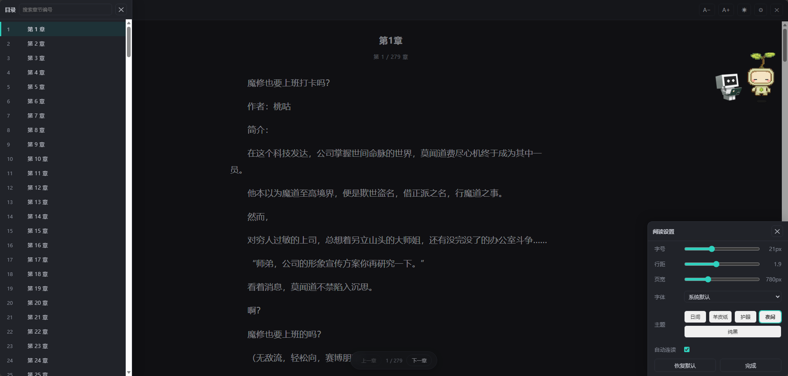
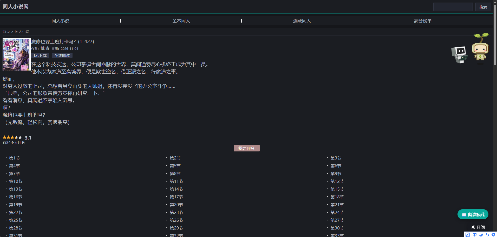

# trxs-reader

**同人小说网 trxs.cc 阅读增强油猴脚本** —— 阅读模式 · 夜间模式 · 去广告

[](LICENSE)
[](https://www.tampermonkey.net/)
[](https://greasyfork.org/zh-CN/scripts/603684)
[](https://github.com/zzyoxml/trxs-reader/actions/workflows/test.yml)

> 这个网站阅读模式、夜间模式啥也没有。

| 阅读模式（羊皮纸主题 + 设置面板） | 站点级夜间模式 |
|---|---|
|  |  |

---

## 为什么不能直接用通用脚本

市面上常见的通用小说阅读脚本（如各类「小说阅读模式」）依赖 Readability 通用正文提取加一堆 `SITE_RULES` 选择器猜测。它们在 trxs.cc 上失效，原因有两个：

1. **编码**：trxs.cc 全站是 **GB2312**。异步抓回来的页面按默认 UTF-8 解码，正文全是乱码。
2. **DOM**：正文容器叫 `.read_chapterDetail`，不在任何通用规则覆盖范围内。

所以本脚本直接按站点真实结构写死选择器，抓取和解析全部走 GBK 解码，不再依赖任何通用提取算法。

---

## 安装

### 方式一：Greasy Fork 一键安装（推荐）

**https://greasyfork.org/zh-CN/scripts/603684**

装好后由 Greasy Fork 自动检查更新。

### 方式二：GitHub raw 一键安装

**https://raw.githubusercontent.com/zzyoxml/trxs-reader/main/trxs-reader.user.js**

### 方式三：手动安装

1. 浏览器安装 [Tampermonkey](https://www.tampermonkey.net/) 扩展
2. 打开油猴管理面板 → **「添加新脚本」**
3. 把 [`trxs-reader.user.js`](trxs-reader.user.js) 的内容整体粘贴进去，覆盖模板
4. `Ctrl + S` 保存

安装后打开 `trxs.cc` 的书籍目录页或章节页，右下角会出现悬浮按钮组。

> **关于自动更新**：脚本元数据里没有写死 `@updateURL` / `@downloadURL`，而是让 Tampermonkey 以**安装来源**作为更新地址。所以从 Greasy Fork 装的会走 Greasy Fork 更新，从 GitHub raw 装的会走 raw 更新，两条渠道互不冲突。发布新版本前记得先递增 `@version`。

---

## 功能

### 阅读模式

点击右下角 **📖 阅读模式**，或按 `R` 键进入沉浸式阅读界面：

- 全屏纯净排版，去掉侧栏、推荐位、页脚等一切杂物
- 正文分章渲染，**自动连读**：滚动接近底部时自动追加下一章
- 顶部信息栏显示书名与当前章节，右侧 **A− / A+** 两个按钮可直接增减字号
- 底部悬浮翻页条：**上一章 / 下一章**，显示 `当前章 / 总章数`
- 顶部细进度条显示当前章节内的阅读进度
- **目录侧栏**（`T` 或 ☰ 按钮）：完整章节列表，可按章节号搜索，高亮当前章，点击跳转
- 自动记忆阅读进度，下次进入直接回到上次读到的章节
- 支持图片章节（图片居中显示，不参与正文缩进）

### 夜间模式

**站点级夜间模式**（不进入阅读模式也能用）

- 悬浮按钮第二项 **🌙 夜间 / ☀ 日间** 一键切换
- 覆盖站点 CSS 里写死的白色背景（`body`、`.head`、`.newNav`、`.readContent`、`#readContent_set` 等），文字、链接、搜索框全部适配深色

**阅读器内置 5 套配色**：日间 / 羊皮纸 / 护眼 / 夜间 / 纯黑

### 去广告

trxs.cc 的广告不在 HTML 里，而是由站内 `funNav.js`、`tongji.js` 动态注入第三方脚本。脚本从三个层面处理：

| 层面 | 做法 |
|---|---|
| 拦截注入 | `document-start` 阶段劫持 `document.write` / `writeln`，丢弃含广告域名的写入 |
| 清除节点 | `MutationObserver` 实时移除广告 `script` / `iframe` / `ins` |
| 样式隐藏 | CSS 隐藏广告位、登录注册条 `.membershow`、点评条 `.dp_head`、点击统计 `#onclickshowdiv`、评分弹层 `.star_box` |

拦截的域名：

```
cpt.geniee.jp / geniee.jp
securepubads.g.doubleclick.net / doubleclick.net
googletagmanager.com / google-analytics.com
googlesyndication.com / googleadservices.com / adservice.google.com
pubmatic.com / taboola.com / outbrain.com
```

> **注意**：页面末尾由 Cloudflare 注入的 1px 隐藏 `iframe` 属于验证机制，**不是广告，脚本不会删它**。

去广告、隐藏推荐、隐藏登录条是**固定开启**的，不提供开关。

---

## 快捷键

阅读模式内：

| 按键 | 作用 |
|---|---|
| `←` / `PageUp` | 上一章 |
| `→` / `PageDown` / `空格` | 下一章 |
| `T` | 打开 / 关闭目录侧栏 |
| `D` | 切换夜间 / 日间主题 |
| `Home` | 跳到本章开头 |
| `End` | 跳到本章结尾 |
| `Esc` | 关闭面板；无面板打开时退出阅读模式 |

阅读模式外：

| 按键 | 作用 |
|---|---|
| `R` | 在目录页 / 章节页直接进入阅读模式 |

油猴菜单另有三项：**进入阅读模式**、**切换夜间模式**、**恢复默认设置**。

---

## 阅读设置

点击阅读器工具栏 **⚙** 打开：

| 项目 | 范围 / 选项 |
|---|---|
| 字号 | 14 – 34 px（也可用工具栏 **A− / A+** 快速调档） |
| 行距 | 1.4 – 2.6 |
| 页宽 | 520 – 1400 px |
| 字体 | 系统默认 / 微软雅黑 / 宋体 / 楷体 / 黑体 |
| 主题 | 日间 / 羊皮纸 / 护眼 / 夜间 / 纯黑 |
| 自动连读 | 开 / 关 |

去广告、隐藏推荐、隐藏登录条、显示悬浮按钮属于固定行为，不放进设置面板。

设置通过 `GM_setValue` 持久化，换页、重启浏览器都不会丢；「恢复默认」可一键还原。阅读进度按书籍 ID 分别记录，多本书互不干扰。

---

## 实现要点

### GB2312 解码

通过 `GM_xmlhttpRequest` 以 `responseType: 'arraybuffer'` 拿到原始字节，然后：

1. 从字节头部嗅探 `charset` 声明
2. 优先尝试 **严格 UTF-8 解码**（GBK 的高位字节几乎不可能通过 UTF-8 校验）
3. 失败则回退 `gbk` 解码器

### 站点 DOM 契约

| 位置 | 选择器 |
|---|---|
| 正文容器 | `.read_chapterDetail` |
| 章节标题 | `.read_chapterName h1`（形如「书名 第N章」） |
| 作者 | `.textinfo em`（形如「作者：xxx」） |
| 章节导航 | `.pageNav`，解析其中 `{当前}/{总数}` |
| 目录列表 | `.book_list a[href]`，匹配 `/tongren/{书号}/{序号}.html` |
| 书名 | `.book_info h1`，自动去掉 `(1-165)` 这类范围后缀 |

解析时还会：

- 去掉段首全角空格 `　　`，改用 CSS `text-indent: 2em` 统一缩进
- 过滤 `上一篇` / `下一篇` / `首章` / `尾章` / `目录` 等导航残留
- 合并尾部多余空段落

### 章节总数以实际为准

站点标题里的章节数不可靠。两个实测例子：

| 书名标注 | 实际章数 |
|---|---|
| 《聊天群：人在箱庭，系统刚刚跑路》`(1-1018)` | **338** |
| 《我正经学生，每天只吃九种魔药》`(1-334)` | **445** |

脚本的总章数取自 `.pageNav` 的 `{n}/{total}` 与目录页实际链接数，**不采信标题里的数字**，避免自动连读时反复请求 404。

---

## 开发

```bash
# 安装测试依赖
npm install

# 抓取真实页面样本到 test/fixtures/（不纳入版本库）
npm run fetch-fixtures

# 跑全部测试
npm test
```

### 测试套件

| 命令 | 内容 | 用例数 |
|---|---|---|
| `npm run test:unit` | 解析 / 去广告 / 夜间 / 编码 | 94 |
| `npm run test:integration` | 阅读器全流程 | 48 |
| `npm run test:live` | 真实线上数据 | 71 |

合计 **213 项**，基于 [jsdom](https://github.com/jsdom/jsdom)，样本是从线上抓取的真实 GB2312 原始页面。覆盖：

- 4 个真实章节页的正文提取（含 338 章的长章节）
- 2 个真实目录页的完整章节列表（98 章 / 338 章）
- 404 页面不误判为正文
- 广告脚本拦截、DOM 清理、Cloudflare iframe 保留
- 夜间模式开关、5 套主题、字号 / 行距 / 页宽 / 字体
- 自动连读、目录跳转、翻页、末章边界、进度恢复
- GB2312 严格解码与回退

CI 在每次 push 时跑单元与集成测试；`test:live` 需要联网抓站，不放进 CI。

> `test/fixtures/` 里是站点正文的原样副本，仅作本地回归测试用，**不纳入版本库**（见 `.gitignore`）。仓库只发布脚本代码本身。

---

## 文件结构

```
trxs-reader.user.js         油猴脚本本体
test/
  fetch-fixtures.mjs        抓取真实页面样本
  run.mjs                   单元测试
  integration.mjs           集成测试
  live.mjs                  真实数据测试
  fixtures/                 (本地生成，不提交)
docs/                       截图
LICENSE                     MIT
```

---

## 已知限制

- 桌面端浏览器实测可用；移动端自适应已写（窄屏隐藏书名、收窄内边距），但未做真机测试。
- 结构依赖站点当前 DOM。若站点改版导致正文抓取失败，欢迎提 Issue。

---

## 免责声明

本脚本仅改变页面的**显示方式**（排版、配色、隐藏广告位），**不抓取、不存储、不转载**任何小说正文。所有内容版权归原作者及原网站所有。请支持正版，仅供学习交流使用。

---

## License

[MIT](LICENSE) © 2026 zzyoxml
